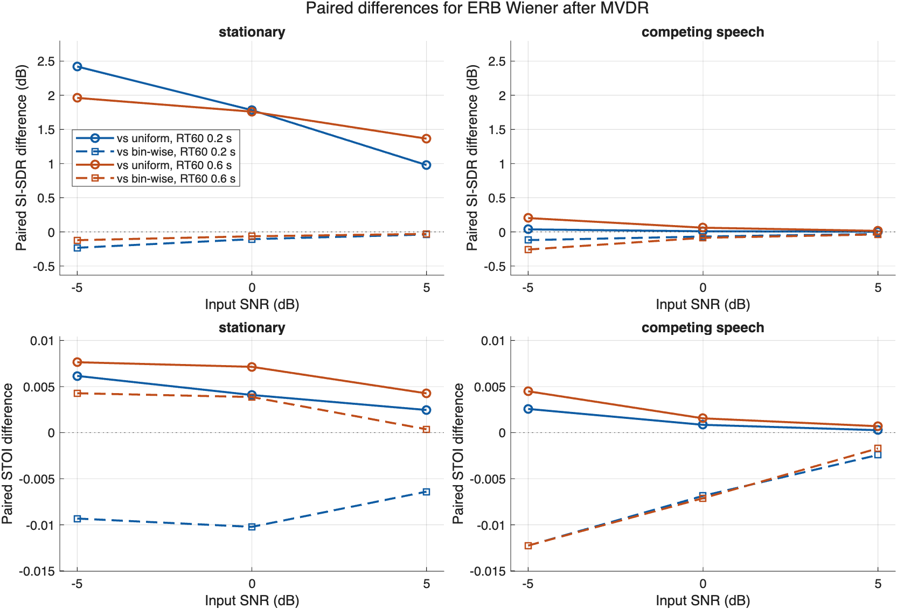

# Follow-up experiment with Recordings 3 and 4

The follow-up tests whether the results from [Recordings 1 and 2](../recording_study/)
also appear on two additional recordings. The most consistent finding across
the two pairs is the SI-SDR benefit of ERB over uniform grouping in stationary
noise. The size of the benefit in competing speech varied by recording pair.
The project author identifies Recordings 1 and 2 as female voices and
Recordings 3 and 4 as male voices.

## Matched experimental design

Recording 3 and Recording 4 are 45.483 and 35.840 s, respectively. Each was
decoded at 48 kHz, averaged to mono, and resampled to 16 kHz. The follow-up
uses the same six windows beginning at 1, 6, 11, 16, 21 and 26 s as the original
experiment, with both assignments of target and interferer. The two pairs use
the same array geometry, simulation seeds, STFT, MVDR calibration and Wiener
gain settings. Each pair contributes 12 target-role excerpts, tested under
12 conditions and three seeds for 432 mixtures. The condition means weight
both pairs equally, after averaging seeds within each excerpt.

## Comparison

The table reports the range of mean SI-SDR differences across the six
conditions for each noise type. Positive differences favour ERB.

| Interference | Compared with | Recordings 1 and 2 | Recordings 3 and 4 | Both pairs |
|---|---|---:|---:|---:|
| Stationary noise | Uniform bands | +0.44 to +1.08 dB | +0.98 to +2.42 dB | +0.71 to +1.75 dB |
| Stationary noise | Bin-wise | −0.15 to −0.03 dB | −0.23 to −0.03 dB | −0.19 to −0.03 dB |
| Competing speech | Uniform bands | +0.08 to +0.88 dB | +0.002 to +0.202 dB | +0.04 to +0.54 dB |
| Competing speech | Bin-wise | −0.31 to +0.05 dB | −0.26 to −0.03 dB | −0.29 to +0.001 dB |

At −5 dB with competing speech and an achieved T20 of 0.566 s, ERB relative
to bin-wise processing increased interference attenuation by **0.74 dB**
on the original pair and **0.34 dB** on the follow-up pair. Target error
increased by **0.40 dB** and **0.12 dB**, respectively. SI-SDR decreased
by **0.31 dB** and **0.26 dB**. The same trade-off appears on both pairs in
that condition. On the follow-up pair, ERB also reduced across-seed gain
variance by 41–46% relative to uniform grouping across the four noise/room
combinations. Gain variance measures stability at fixed time-frequency
points. SI-SDR and STOI also reflect how processing changes the target.

## Input sensitivity

Recording 3 had 13 decoded samples at or above 0.99 in one channel in the
window starting at 1 s. To check the influence of this segment, the comparison
was repeated with the 1 s window removed from both recording roles. ERB's
stationary-noise advantage over uniform bands remained positive in all six
conditions. In competing speech the ERB−uniform differences were between
**−0.023 and −0.003 dB in five of six conditions**. The remaining condition,
−5 dB at nominal RT60 0.6 s, gave **+0.109 dB**. The ERB−bin-wise SI-SDR
differences remained negative in all 12 conditions for the follow-up pair.

The results describe four recordings used as sources for one simulated array
geometry, paired as 1/2 and 3/4. Each voice group contributes one recording
pair, and source material and the recording setup may also differ. The
differences are therefore reported at the recording-pair level.

[Comparison CSV](comparison_with_original.csv) · [Excerpt scores](excerpt_means.csv) ·
[All mixture scores](all_scores.csv) · [Input metadata](inputs.csv) ·
[Listening examples](listening_example/) ·
[Reproduction instructions](../../README.md#status-and-requirements)
