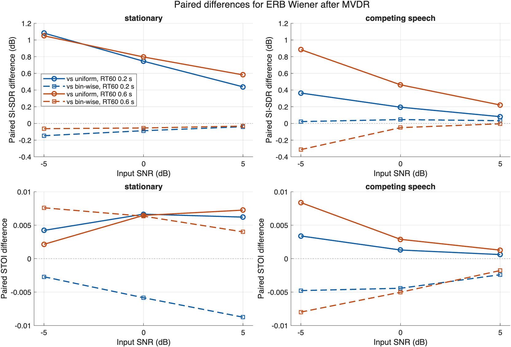
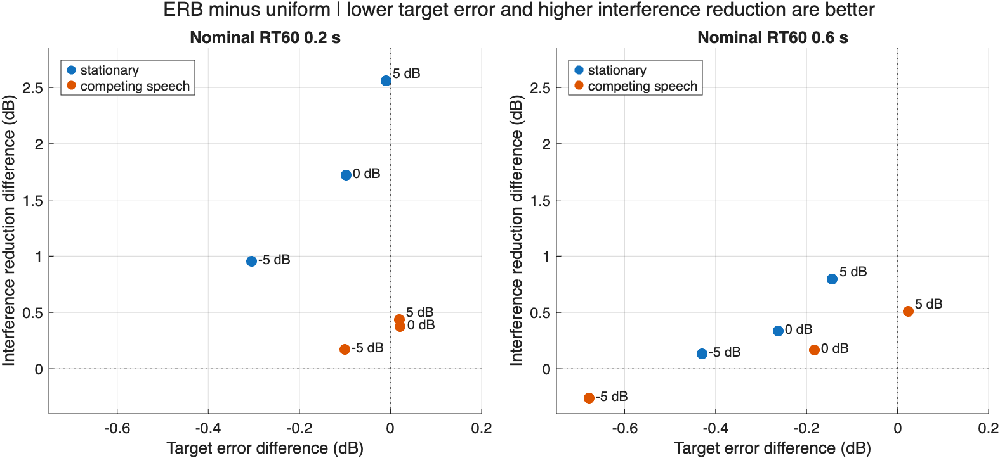

# Real-recording case study

**Research question.** After the same MVDR beamformer, does ERB-spaced Wiener
grouping improve the result compared with per-bin gains or uniform-Hz grouping?

Across the 12 tested conditions, ERB had a higher mean SI-SDR than uniform
grouping by **0.08 to 1.08 dB**. Against bin-wise processing, the corresponding
differences were **−0.31 to +0.05 dB**. On these recordings, the benefit of ERB
depends on the comparison method and the acoustic condition.

## Test design

- `Recording1.m4a` and `Recording2.m4a` contain 31.829 and 33.195 s of recorded
  female speech at 48 kHz. Both decoded stereo peaks were below full scale. Channels
  were averaged and resampled to 16 kHz. All excerpts and input levels are
  listed in [inputs.csv](inputs.csv). The sources may contain recording-room
  sound and device processing. They serve as recorded source proxies.
- Six disjoint 5 s windows start at 1, 6, 11, 16, 21 and 26 s in each file.
  At each start time, the files swap target and interferer roles. The target
  uses the first 4 s after 1 s of simulated target absence. For competing
  speech, the interferer plays its entire 5 s window. A target-role excerpt
  is the repeated unit. The recordings may share a speaker or recording setup.
- Each target-role excerpt is tested under directional stationary noise and
  competing speech, at input SNRs −5, 0 and +5 dB, nominal RT60 values of 0.2
  and 0.6 s, and seeds 5305–5307. This yields 432 mixtures. Stationary-noise
  seeds vary the directional realization and background. Competing-speech seeds
  vary the background with the same interfering excerpt. The simulated
  reference-mic RIR had broadband extrapolated T20 values of **0.1888** and
  **0.5662 s**, using image-source orders 24 and 36, respectively. Orders were
  selected on the RIRs before speech scoring. See [rooms.csv](rooms.csv).
- Each mixture goes to seven methods. The three key comparisons share the
  exact MVDR output, calibrated noise PSD, temporal smoothing, and gain floor.
  The uniform and ERB variants share 24 triangular bands; their centre spacing
  changes with the frequency scale. The controlled comparison uses the fixed
  proposal settings. Differences are paired on identical mixtures, averaged
  across seeds within each target-role excerpt, then summarized across excerpts.

## What the signal diagnostics show

The component analysis reuses the **actual** MVDR weights and post-filter gains
estimated on the mixture. It applies those fixed weights and gains separately
to the simulated target and interference, solely for evaluation. Their time
signals sum back to the processed mixture. With target reference `s`, filtered
target `s_hat`, and filtered interference `n_hat`, the squared output error is
`||s_hat-s||² + ||n_hat||² + 2⟨s_hat-s,n_hat⟩`. The raw table includes all three
terms divided by reference energy, so it preserves the cross term. Lower target
error and higher interference reduction are preferable. The target reference is
the reverberant target component at microphone 2, including the RIR tail.

| Condition | ERB comparison | Δ SI-SDR | Δ STOI | Δ target error | Δ interference reduction |
|---|---|---:|---:|---:|---:|
| Stationary noise, −5 dB, nominal 0.2 s | Uniform | +1.083 dB | +0.0042 | −0.305 dB | +0.953 dB |
| Stationary noise, −5 dB, nominal 0.2 s | Bin-wise | −0.147 dB | −0.0027 | −0.049 dB | −0.367 dB |
| Competing speech, −5 dB, nominal 0.6 s | Uniform | +0.884 dB | +0.0084 | −0.679 dB | −0.261 dB |
| Competing speech, −5 dB, nominal 0.6 s | Bin-wise | −0.314 dB | −0.0080 | +0.398 dB | +0.742 dB |

In the high-reverberation competing-speech example, ERB's SI-SDR advantage over
uniform grouping coincides with less target error and **weaker** interference
attenuation. The bin-wise comparison reverses the trade-off: ERB attenuates
more interference but increases target error. Its reference-error SNR improves
by 0.446 dB over bin-wise in that condition while SI-SDR and STOI both fall.
This is why the study reports all three metrics and the component terms.

The stationary-noise SI-SDR difference versus uniform grouping was positive for
all 12 target-role excerpts in each of the six tested conditions. With competing
speech the condition means also favoured ERB over uniform, with 9–11 of 12
target-role excerpts improving. The comparison with bin-wise was more sensitive
to the target. For the hardest competing-speech condition, the paired mean
SI-SDR differences were **+0.085 dB** with Recording1 as target and **−0.712 dB**
with Recording2 as target. The roles change both target and interferer, so this
pattern cannot isolate a speaker or utterance effect.

Average gain variance across the three seeds was **33–42% lower** for ERB than
for uniform grouping across the four noise/room combinations. This measures
repeatability at the same time-frequency bins on energetic reference frames.
The competing speech stays fixed across seeds, so its variance captures
background sensitivity. The worst competing-speech calibration mismatch was
**+21.68 dB** in the ratio of actual MVDR interference power during energetic
evaluation frames to its estimated calibration PSD. That case used the
26 s excerpt of Recording2 as interferer, whose first second was about 18 dB
quieter than its following 4 s. This diagnostic shows a limit of the shared
fixed noise model. It does not attribute every score difference to calibration.

## Relationship to ELEC5305 labs

- Week 4's STFT and overlap-add design is used with a 64 ms square-root Hann
  window and 16 ms hop. The reconstruction test had relative error `2.0812e-16`.
- Weeks 6A–C motivate auditory spacing, activity checks, and evaluation of
  Wiener masks. This study uses ERB spacing for triangular averaging of the
  shared PSD estimates. The reference-based −30 dB energy gate applies only
  to diagnostics, and the implemented Wiener gain uses mixture estimation.
  Week 6's ideal mask uses separately available components and illustrates a
  different information assumption.
- Week 12's MVDR constraint and covariance regularization motivate the spatial
  baseline. The study freezes its noise covariance after target-absent
  calibration and uses known direct-path geometry. The KKT cross-check passed
  with weight error `1.4752e-16`. The optional Phased Array System Toolbox
  cross-check was unavailable.

Published auditory-domain post-filtering motivates the controlled comparison
with ordinary grouping. The project tests a particular ERB-inspired weighting
on top of a fixed beamformer and estimator. Further analysis should focus on
the shared PSD mismatch before adding more processing methods.
[Li et al. (2008)](https://www.isca-archive.org/iscslp_2008/li08c_iscslp.html)

## Scope and reproduction

These are descriptive results for two supplied recordings and a single
simulated array geometry. The 12 excerpts and three seeds do not establish
speaker-level uncertainty or generalization. STOI compares each output to the
reverberant reference. Human listening performance and measured multichannel
recordings were outside this experiment.

[Run instructions](../../README.md#status-and-requirements) ·
[All mixture scores](all_scores.csv) · [Seven-method means](methods_overall.csv) ·
[Paired condition summaries and excerpt ranges](paired_conditions.csv) ·
[Paired scores by target recording](paired_by_recording.csv) ·
[Listening examples](listening_example/) ·
[Across-seed gain variance](gain_variance_summary.csv) ·
[Calibration diagnostic](noise_psd_diagnostic.csv)
